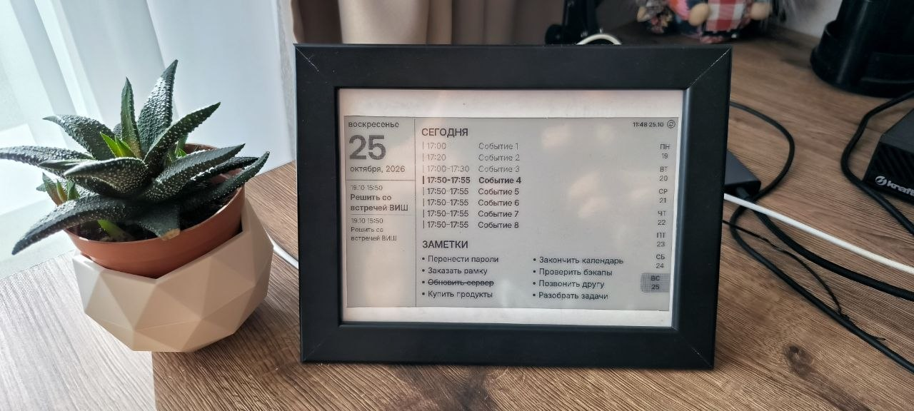
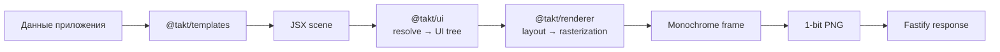

# Takt



Takt — self-hosted сервис для создания информационных экранов, ориентированный на монохромные e-paper дисплеи. Интерфейс экрана описывается декларативно на TSX, после чего Takt строит layout, растеризует его в чёрно-белый framebuffer и отдаёт готовое PNG-изображение по HTTP.

Проект находится на ранней стадии разработки. Сейчас репозиторий содержит
рабочий rendering pipeline, календарные шаблоны и Fastify backend с локальным
SQLite/libSQL-хранилищем, API редактирования и SSE. CalDAV-синхронизация,
web-интерфейс и firmware пока не реализованы.

## Что уже работает

- custom JSX runtime без React;
- типизированные UI-примитивы: `Text`, `Rect`, `Line`, `Image`, `Group`, `Flex`, `Row` и `Column`;
- двухфазный layout `measure` / `arrange`;
- рендеринг текста, геометрии и растровых изображений;
- threshold, ordered и Floyd–Steinberg dithering;
- монохромный framebuffer и экспорт в 1-bit PNG;
- календарный экран 800 × 480 и splash screen;
- Fastify endpoint для генерации экранов;
- API заметок, событий и дедлайнов с повторением и exceptions;
- семантические hashes экранов и SSE-уведомления;
- PNG и packed 1-bpp framebuffer для ESP;
- unit-, integration- и compile-time tests.

## Быстрый старт

Понадобятся Node.js 22 и npm.

```bash
npm install
npm test
npm start
```

После запуска backend слушает `http://localhost:3000`:

```text
GET http://localhost:3000/screens/main
GET http://localhost:3000/screens/main/png
GET http://localhost:3000/screens/main/esp
GET http://localhost:3000/screens/events
```

Полный HTTP-контракт описан в [документации API](docs/api.md). Для режима
разработки с автоматической пересборкой:

```bash
npm run dev
```

Переменные `HOST` и `PORT` позволяют изменить адрес сервера:

```bash
HOST=127.0.0.1 PORT=3001 npm start
```

Подробные требования и все команды приведены в [руководстве по запуску](docs/getting-started.md).

## Пример экрана

```tsx
import { Column, Rect, Text } from '@takt/ui/components'

const screen = (
    <Column width={800} height={480} padding={24} gap={12}>
        <Text size="h1">Сегодня</Text>
        <Rect width={752} height={1} fill fillColor="gray_50" />
        <Text fontSize={20}>10:00 — Встреча</Text>
        <Text fontSize={20}>Без времени окончания</Text>
    </Column>
)
```

Это не React-компоненты: `@takt/ui` предоставляет небольшой JSX runtime, предназначенный только для описания экранов.

## Архитектура



| Workspace            | Ответственность                                          |
| -------------------- | -------------------------------------------------------- |
| `packages/ui`        | JSX runtime, UI-примитивы и нормализованное дерево узлов |
| `packages/renderer`  | Layout, растеризация и экспорт PNG                       |
| `packages/templates` | Проекты, сцены и календарные шаблоны                     |
| `apps/backend`       | Node Canvas environment и HTTP API                       |

Подробное описание зависимостей и потока данных находится в [архитектурной документации](docs/architecture.md).

## Команды

| Команда                     | Назначение                                |
| --------------------------- | ----------------------------------------- |
| `npm run build`             | Полная сборка TypeScript workspaces       |
| `npm run build:incremental` | Инкрементальная сборка                    |
| `npm run dev`               | Watch-сборка и backend в development mode |
| `npm start`                 | Запуск собранного backend                 |
| `npm test`                  | Сборка и запуск тестов                    |
| `npm run typecheck`         | Проверка TypeScript contracts             |
| `npm run lint`              | Проверка ESLint                           |

## Документация

- [Обзор документации](docs/README.md)
- [HTTP API](docs/api.md)
- [Архитектура](docs/architecture.md)
- [JSX и UI tree](docs/concepts/jsx-ui-tree.md)
- [Layout и rendering](docs/concepts/layout-rendering.md)
- [Проекты и сцены](docs/concepts/scenes.md)
- [Расширение проекта](docs/development.md)

## Статус и планы

Следующие крупные части пока остаются планами:

- двусторонняя CalDAV-синхронизация;
- web-интерфейс управления и preview;
- firmware для ESP32-S3 и дисплея 800 × 480.

## Лицензия

Проект распространяется по лицензии [MIT](LICENSE).
