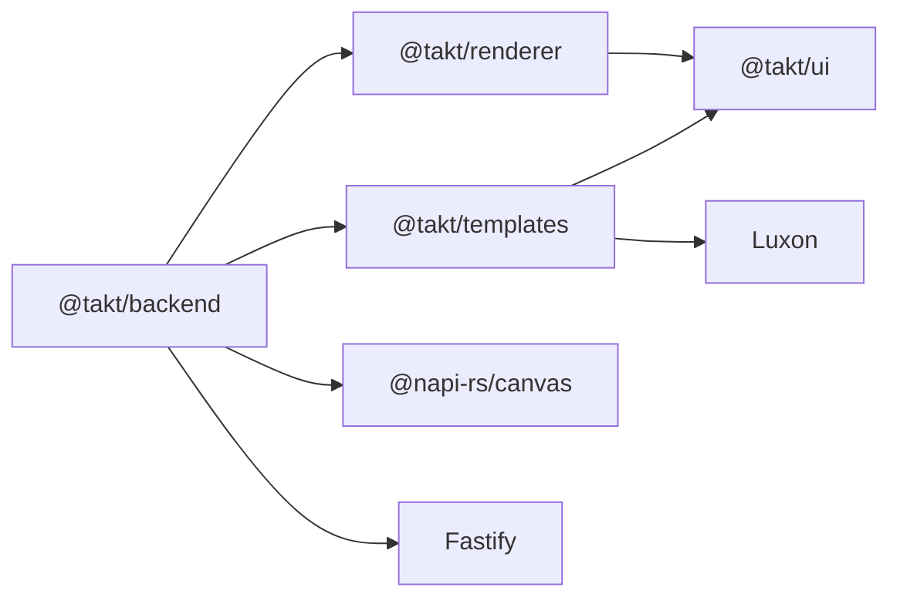
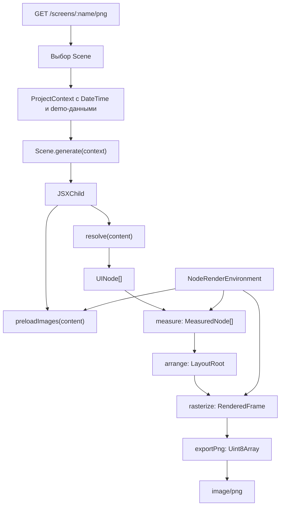

# Архитектура

Takt в текущем виде строит монохромное изображение экрана из TypeScript/TSX-описания. Application layer выбирает сцену и готовит данные; `templates` превращает их в JSX; `ui` разрешает JSX в нормализованное дерево; `renderer` вычисляет геометрию и заполняет пиксельный буфер; backend предоставляет платформенные операции для текста и изображений и отдаёт PNG по HTTP.

## Структура monorepo

```text
apps/
└── backend/          Fastify-приложение и Node Canvas environment
packages/
├── ui/               JSX runtime, UI-примитивы, resolve()
├── renderer/         layout, rasterization, PNG exporter
└── templates/        project/scene contracts и календарные сцены
tests/                интеграционные, unit- и type-contract тесты
```

Корневой npm workspace включает `packages/*` и `apps/backend`. TypeScript project references повторяют эти границы.

## Зависимости



`ui` не зависит от renderer или Node.js. Renderer знает только UI tree и функции `RenderEnvironment`, а не календарную модель. Templates не читает данные из хранилища: сцены получают готовый `ProjectContext`. Backend связывает все уровни и поэтому является composition root.

## Поток данных



Backend сначала вызывает `preloadImages`, потому что общий `RenderEnvironment.loadImage` синхронный, а декодирование изображений через Node Canvas асинхронное. Затем `createRenderer` выполняет `resolve`, layout и rasterization синхронно. Экспорт PNG асинхронен из-за `CompressionStream`.

## Структуры на этапах

| Этап | Структура | Важные свойства |
| --- | --- | --- |
| Scene generation | `JSXChild` | Может содержать компоненты, fragments, массивы, строки, числа и пустые значения |
| Resolution | `UINode[]` | Только зарегистрированные primitive type, нормализованные props и дочерние узлы; функции устранены |
| Measurement | `MeasuredNode` | `size`, измеренные дети и handler-specific `additionalData` |
| Arrangement | `LayoutRoot` / `LayoutNode` | Абсолютные `bounds`; сохранены node и layout data |
| Rasterization | `RenderedFrame` | `width`, `height`, row-major `Uint8Array`; один byte на pixel, `0 = white`, `1 = black` |
| Export | 1-bit grayscale PNG | MSB-first packing внутри строки PNG; PNG использует обратную grayscale polarity (`1 = white`) |

## Разделение ответственности

- **UI** определяет допустимые узлы и один раз нормализует входные props. Он не измеряет текст и не рисует.
- **Layout** измеряет узлы снизу вверх, затем размещает детей сверху вниз. Платформенные измерения получает через environment.
- **Rasterization** обходит готовый layout в порядке узлов и рисует в общий буфер с clipping по viewport.
- **Templates** знают о календарных данных и композиции конкретного экрана, но не о Fastify или Canvas.
- **Backend** создаёт контекст, выбирает сцену, предоставляет Node-реализацию environment и формирует HTTP response.

Подробнее: [JSX и UI tree](concepts/jsx-ui-tree.md), [layout и rendering](concepts/layout-rendering.md), [проекты и сцены](concepts/scenes.md).

## Пока не реализовано

Локальное SQLite-хранилище, mutation API, semantic revision hashes, SSE и
выдача PNG/ESP framebuffer уже реализованы. Пока отсутствуют CalDAV sync,
device registration/authentication, web UI и firmware. Актуальный transport
contract описан в [HTTP API](api.md).

