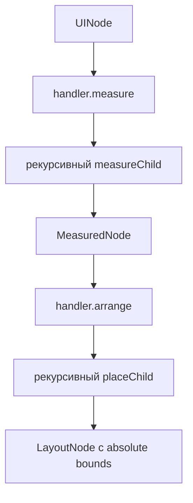

# Layout и rendering

## Координаты и размеры

Начало viewport — `(0, 0)`, `x` растёт вправо, `y` вниз. Root bounds всегда `{ x: 0, y: 0, ...viewport }`. `x/y` root nodes интерпретируются относительно viewport; nested nodes — относительно bounds родителя.

`Size` содержит `width/height`, `Bounds` добавляет `x/y`. Координаты layout могут быть fractional. Перед pixel drawing прямоугольные bounds расширяются через floor/ceil, а запись обрезается по viewport.

В `Text`, `Flex` и `Image` значение `-1` после нормализации означает natural/auto size. Это внутренний sentinel, а не общий constraint mechanism.

## Measure и arrange

Measure идёт снизу вверх. Handler получает node, текущие `constraints`, `measureChild`, а также environment functions `measureText` и `loadImage`. Результат содержит size, measured children и optional `additionalData`.

Arrange идёт сверху вниз. Handler получает собственные absolute bounds и `placeChild(child, localX, localY)`, который добавляет parent origin. В `additionalData` текст хранит рассчитанные строки/offsets, а image — decoded RGBA, чтобы не повторять работу при drawing.

Хотя constraints прокидываются рекурсивно, текущие handlers не ограничивают ими рассчитанные размеры.

## Правила built-in handlers

### Group

Измеряет всех детей. Natural width/height — максимум `child.x + child.width` / `child.y + child.height`; children размещаются по собственным `x/y`. Group не имеет explicit size props.

### Flex, Row и Column

Measure суммирует размеры по main axis, добавляет `gap` и padding; cross axis берёт maximum. Explicit non-negative width/height заменяет natural size. Arrange реализует `justify` (`start`, `center`, `end`, space variants) и cross-axis `align` (`start`, `center`, `end`).

`gap` сохраняется даже при space distribution. Free space clamp-ится к нулю: при overflow children не сжимаются и могут выйти за bounds.

### Text

Текст сначала разбивается по `\n`. При `maxLineWidth >= 0`:

- `cut` оставляет максимальный grapheme prefix;
- `emphasis` резервирует место под `...`;
- `line` переносит по ASCII spaces; одно длинное слово не режется.

Измерение graphemes использует `Intl.Segmenter`. Межстрочный шаг равен `max(measuredHeight, fontSize × lineHeight)`. Explicit width/height задают container для alignment, но не clip region.

### Rect и Line

Rect возвращает explicit size. Line возвращает `abs(dx)`, `abs(dy)`, однако drawing трактует bounds origin как начало вектора. Поэтому layout bounds линии не являются точным visual bounding box, особенно для negative direction и stroke width.

### Image

`loadImage(src)` должен вернуть валидный positive-size RGBA buffer. Без explicit dimensions используется natural size; одна заданная сторона сохраняет aspect ratio; две стороны используются буквально.

## Rasterization

`rasterize` создаёт zero-filled frame, где `0 = white`. Для каждого layout node ищется draw handler, после чего рекурсивно рисуются дети. `Group` и `Flex` draw handler не имеют.

Gray colors реализованы пространственным 2×2 Bayer pattern. Text bitmap содержит alpha `0..255`; pixel рисуется, если alpha не меньше `renderThreshold`. Images сначала scale-ятся, затем сводятся в monochrome с учётом alpha и текущего background frame.

Поддерживаемые image options:

- fit: `contain`, `cover`, `fill`;
- sampling: nearest (`smoothing: false`) или alpha-aware bilinear;
- brightness: `perceived`, `average`, `lightness`, отдельный RGB channel;
- dithering: `threshold`, ordered Bayer 4×4, Floyd–Steinberg;
- threshold clamp `0..255` и optional inversion.

## Environment contract

Renderer требует, чтобы `measureText(value, style)` и `rasterizeText(value, style)` возвращали одинаковую geometry для одной пары input. Нарушение приводит к неверному alignment, хотя отдельной runtime validation нет. `DecodedImage.data` — row-major RGBA, четыре bytes на pixel.

Node implementation описана в [backend](../packages/backend.md).

## PNG exporter

`exportPng` принимает только positive integer dimensions и buffer длиной `width × height`. Строки дополняются до целого byte; pixels укладываются MSB-first. Поскольку PNG grayscale кодирует `0 = black`, `1 = white`, exporter инвертирует internal `FramePixel` polarity при packing. Используются filter None, deflate compression и no interlace.

