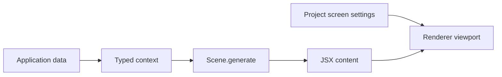

# Проекты и сцены

Scene отделяет получение данных от presentation. Это named generator, который получает внешний context и возвращает `JSXChild`. Project объединяет screen settings и map сцен.



## Контракты

```ts
interface Scene<TContext = unknown> {
    readonly generate: (context: TContext) => JSXChild
}

interface Project<TContext, TSettings, TScenes> {
    readonly settings: TSettings
    readonly scenes: TScenes
}
```

`ProjectSettings` требует только `screen.width` и `screen.height`. Generic `TSettings` сохраняет дополнительные fields и literal values. `TScenes` сохраняет точные scene names. Type-contract test подтверждает inference context generator и custom settings.

## Создание сцены

```tsx
interface StatusContext {
    readonly title: string
    readonly updatedAt: string
}

const status = defineScene((ctx: StatusContext) => (
    <Column gap={4}>
        <Text size="h2">{ctx.title}</Text>
        <Text>{ctx.updatedAt}</Text>
    </Column>
))
```

Context передаётся явно. Context API, provider или mutable request-global render state не реализованы.

## Bundled calendar model

- `Event`: `start: DateTime`, optional `end: DateTime`, `text`.
- `Deadline`: `date: DateTime`, `text`, optional `important`.
- `Note`: `text`, optional `done`.

`main` scene помечает событие active в интервале от 15 минут до начала до его
конца; если end отсутствует, временное окно заканчивается через 15 минут после
start. Прошедшие события рисуются gray. Этот calculation находится в template
component, не в backend/domain service.

`today` одновременно используется как current time для event state и как
timestamp последнего формирования ответа.

## Config side effect

Optional config в `defineProject(config)` вызывает глобальный `@takt/ui` `setConfig` во время определения проекта. Bundled project задаёт `Inter` для всех typography presets. Это process-wide side effect: API не изолирует configs нескольких проектов или параллельных requests. Текущий backend создаёт один project на module load, поэтому в существующем execution path конфликтов нет.

## Что не входит в Scene

Scene не хранит resolved tree, rendered frame, revision или persistence identifier. Project не управляет active scene и не содержит device settings кроме screen dimensions. Хранение выбора сцены, сериализация code-defined generators и пользовательское редактирование templates не реализованы.

